# torus

My own Arch + Hyprland setup: Catppuccin everywhere, Mocha by default.

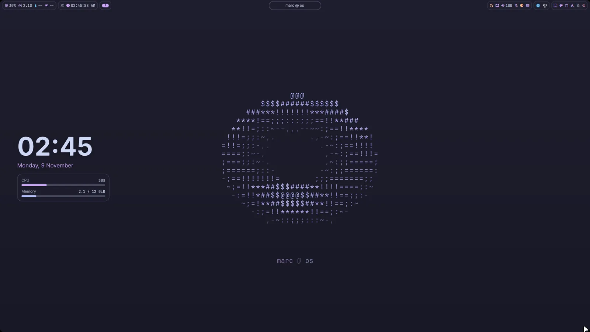

## Gallery

| | |
|:---:|:---:|
| 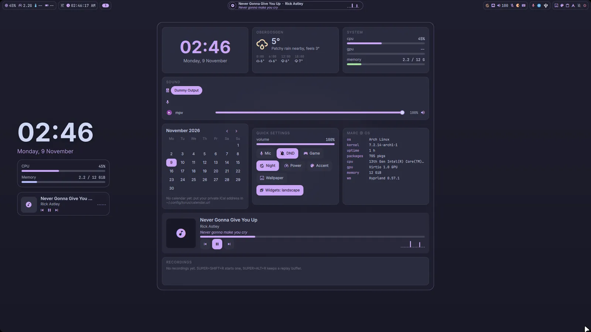 | 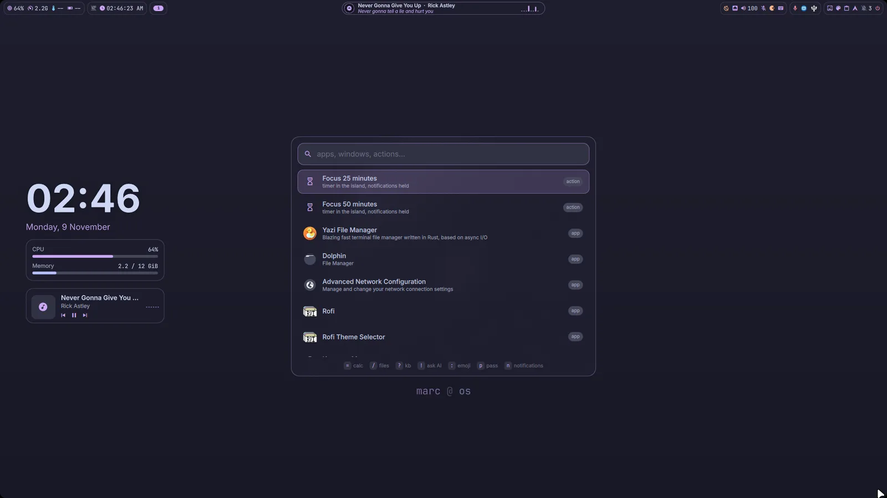 |
| The dashboard: weather, stats, a sound mixer per app, calendar | SUPER+Space: apps, windows, actions, calc, files, notes, passwords |
| 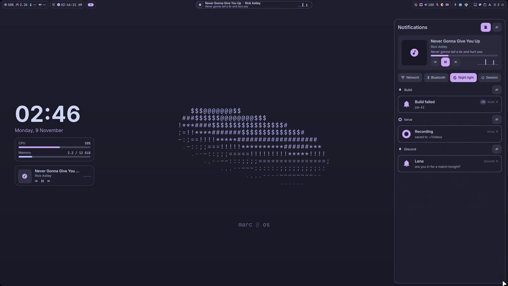 | 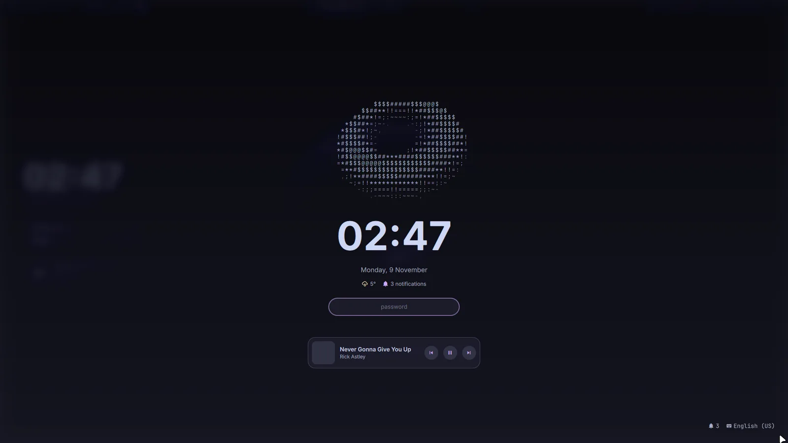 |
| Notifications, grouped per app and per conversation, repeats folded into one | The lock screen, with what is playing right under the password |
| 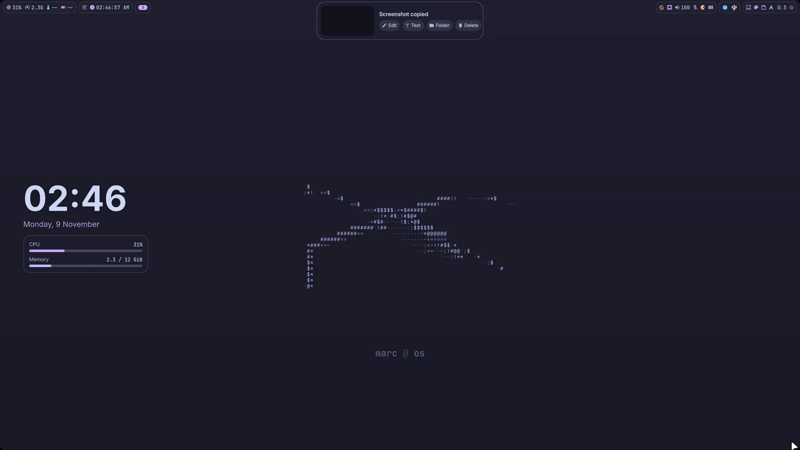 | 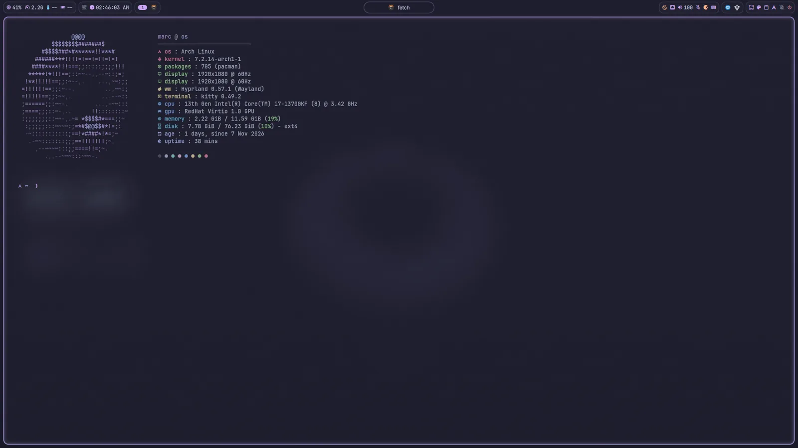 |
| An X-wing, because why not | fastfetch, with a donut that spins for a second |
| 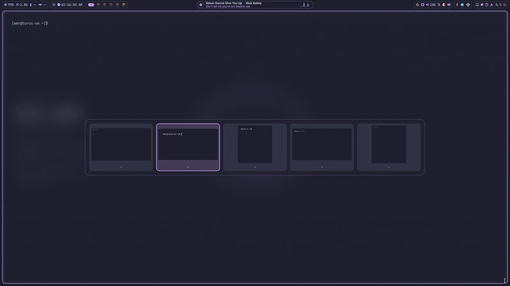 | 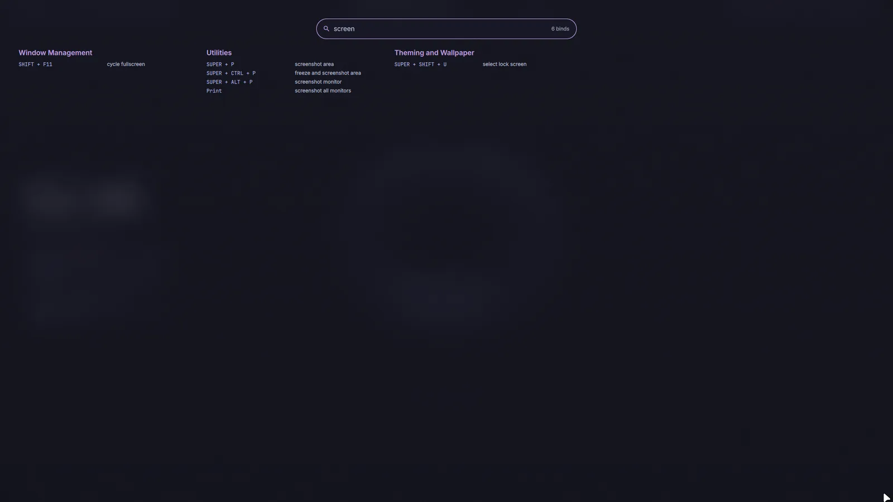 |
| Alt-tab with live previews | A cheat sheet of every bind, searchable |
| 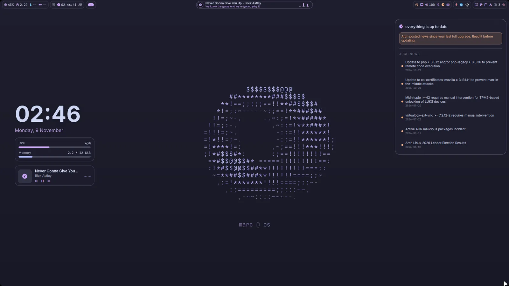 | 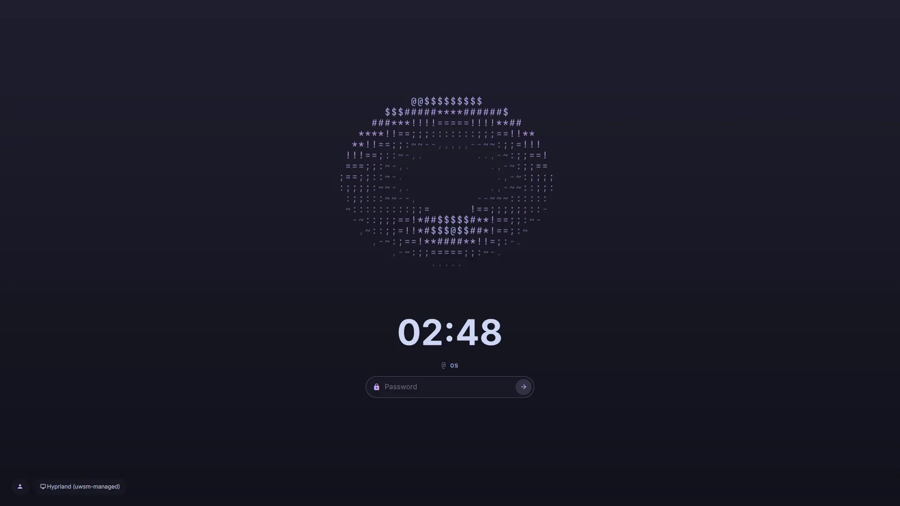 |
| Updates, with the Arch news that matters before you upgrade | The login screen, same donut |

The small things:


| | |
|:---:|:---:|
| 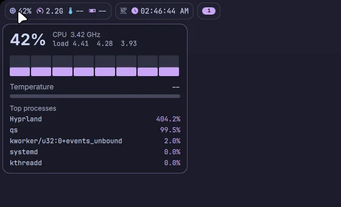 | 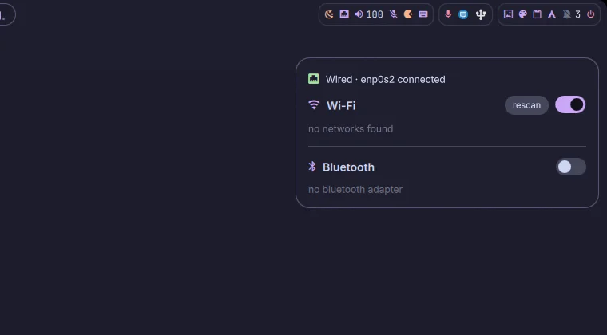 |
| Hover the bar for the details | Wi-Fi and Bluetooth without leaving the bar |

## Why

I ran [HyDE](https://github.com/HyDE-Project/HyDE) for a long time. It is good, but most of my desktop
lived in files that get overwritten on every update, and one migration quietly took my window rules
with it. I want a setup I own end to end.

## What it does

- A Quickshell shell: bar, dashboard, notifications, a dynamic island for music and alerts, lock screen.
- SUPER+Space: one box for apps, windows, math, paths and links, no prefixes to remember. Tab steps through the scopes, `?` lists them, and Proton Pass only answers in its own.
- `d` in SUPER+Space: every git repo under `~/dev` with its branch and how much is dirty. Enter opens a terminal there, Ctrl+Enter nvim, Alt+Enter the repo page.
- Alt+Shift+Enter on a project in SUPER+Space opens its whole workspace: nvim, a terminal and the repo page side by side (or what the repo's `.torus-layout` lists: `nvim`, `term`, `lazygit`, `repo`, `url ...`, nothing else runs). Containers group by compose project, with a restart for the whole project.
- `s` in SUPER+Space: the hosts from `~/.ssh/config`, Enter connects in kitty, the ones I use most come first.
- A dev pill in the bar that only shows up when it has something: my dev servers (hover for port, folder and command, click opens, the square stops), running Docker or podman containers (logs, restart, stop, also `c` in SUPER+Space) and GitHub.
- A controller pill with its battery, only while a controller is connected.
- SUPER+Shift+G: my Steam games as covers, last played first, with playtime; type to filter, Enter plays.
- Games get their own replay buffer: it starts with the game on its screen, SUPER+Alt+R files a clip under `~/Videos/Clips/<Game>` and the island says so. Each game in SUPER+Shift+G has a cog (or Ctrl+Enter) that opens its settings as plain switches: FPS overlay, power profile, held notifications, the replay buffer and its length, what clips record, and for CS2 which moments become auto clips. When the game closes, the island sums up the session: time, average FPS, 1 % low, GPU heat, clips.
- Counter-Strike 2 clips itself: through Valve's Game State Integration (127.0.0.1 only, with a token) torus saves the replay buffer on an ace, a 4K, a 3K or a clutch, names the clip after it with an AUTO badge in the clip strip, and the recap after the match has the map, score, K/D, MVPs and best round. Nothing shows during a round. Each event can be switched off in the game's settings, and `torus-gsi uninstall` removes the cfg.
- The pencil on a clip (or Ctrl+E) opens a cutter: the clip with a filmstrip, `[` and `]` (or a drag on the strip) mark the part, Space plays it, Enter saves it next to the original in an instant (cut on keyframes, no re-encode), Ctrl+Enter twice keeps only that part and trashes the rest. Each game picks what its clips record: everything, the game and my mic, or just the game.
- When Steam processes Vulkan shaders before a game, the island shows a ring with the game, the percent and how long is left (from the speed over the last minute), the game's cover in SUPER+Shift+G shows it too, and the island says when the game is ready to play. It follows Steam's own log, so nothing runs or polls while Steam is idle.
- My two monitors' brightness over DDC in the dashboard and on the brightness keys: the OSD shows the new level at once while the slow monitor catches up, a drag makes one write, "Both together" moves them as one, and night light can dim them a few steps too.
- Tab in SUPER+Shift+G (or the Clips switch) shows every game's clips in one grid, newest first: a click or Enter plays one, chips per game, Ctrl+S stars a clip and Ctrl+F shows only the starred ones, and a starred clip can never be deleted.
- Headphones and controllers show their battery on the island when they connect, and warn me once when they drop under 20 %.
- Browser downloads get a spinning ring on the island with size and speed, and when one finishes a notification offers Open and Show in folder.
- On the laptop the dashboard shows the battery's health and cycles, and a switch to stop charging at 80 % when the firmware has one (`sudo ./install.sh --system` once allows it; torus never flips it by itself).
- Update in the updates panel shows me new Arch news first and waits for my OK, then runs the upgrade and `torus doctor`, and the island tells me how it went.
- SUPER+Shift+C shows everything I captured in one place: screenshots, recordings and game clips, with small cached previews so it opens instantly. The pencil on a clip opens the same cutter.
- `torus doctor` on the laptop checks this boot for panel self refresh freezes and prints the exact kernel parameter that fixes them.
- An optional disk budget for my clips (off, 25, 50 or 100 GB, under Clips): over it, the oldest clips that are not starred go to the trash after each new clip and the island says how much. Off unless I turn it on.
- Steam downloads and updates get the same ring on the island with the speed and time left, read from Steam's own log and the game's manifest. While a game runs fullscreen nothing shows; "updated" waits until the game is closed.
- When several Steam jobs finish during a fullscreen game, the island lists all of them in one line once I am back, not just the last one.
- SUPER+Shift+M freezes the screen into a ruler: drag a box for its size, Shift+drag for a distance and its angle (add Ctrl and it snaps to straight lines and 45° diagonals), and the color under the cursor shows as hex and rgb (C copies it). Every measurement lands in the clipboard.
- Optional UI sounds (off unless I turn them on in SUPER+Space): a soft click for panels, chimes on lock and unlock, a shutter for screenshots, start and stop for recordings, a trash sound when I delete something, a tick for volume, brightness and mic, network, charger and USB device chimes (the island names the keyboard, mouse or drive), an error tone for a wrong password, and a ding for notifications from apps that have no sound of their own.
- Display layouts per set of screens: arrange them once, "Save display layout" in SUPER+Space (type "display" to see the saved ones), and they come back that way whenever that set is plugged in (desk at work, desk at home, laptop alone).
- Face unlock on the laptop (Howdy, IR camera): the lock looks for me as soon as it locks, a key retries, the password always works. `sudo torus-howdy setup --sudo` turns it on for sudo too, `off` puts everything back.
- When Howdy looks for my face (the lock, or sudo in a terminal) the island shows a scanning ring, draws a check when it knows me and turns red when it does not.
- Touchpad: three fingers sideways switch workspaces, four fingers up open the overview, down the dashboard.
- kitty tells me when a command over 30 s finishes while I am in another window, with its exit status.
- A GitHub chip that only shows up when something wants me: review requests, my pull requests with red CI, a failing main branch. `gh ` in SUPER+Space lists them all.
- After a `git push` in the terminal, torus follows the Actions run for that commit and tells me when CI passed or failed (green or red on the island, Open goes to the run), quiet during DND and games like every notification.
- SUPER+` drops down a terminal in the project of the window I am in, one per project, kept around when hidden.
- Meeting mode: when an app has my mic and my camera or a screen share, notifications wait and the slideshow pauses until the call ends.
- Calendar events with a Meet, Teams or Zoom link offer Join two minutes before; joining opens the call and holds my notifications at once, until the call lets go of the mic.
- A performance overlay for games (MangoHud in my colors), on and off from SUPER+Space; the GPU chip shows load and heat while I play.
- The donut drawn on the GPU, tinted by the time of day and the album art. Or an X-wing.
- With "living donut" on, the donut spins faster when the CPU works, wobbles when a notification lands and breathes when the machine idles; the X-wing banks toward the workspace I switch to.
- Panels grow and shrink inside a window that never moves, so nothing jumps when their content loads, and a click next to a panel or between notification cards reaches whatever is underneath.
- Every panel works from the keyboard: Tab walks the buttons, switches and sliders with a focus ring, Enter or Space presses, arrows move sliders. Cards that wait on data say so (loading, nothing here, or what failed with a Retry), and a shell reload or waking the screens keeps the bar exactly as it was, no reset values, no toast.
- SUPER+V opens the clipboard instantly even with a thousand entries: fuzzy search with the matched letters lit, pins on top and the rest grouped by today, yesterday and older, a preview of the whole entry on the right (text, image, color with hex, rgb and hsl, link). Enter only copies. Copying something again moves it up instead of adding a second row, a pin asks twice before it goes, and SUPER+Shift+V (or a right click on the clipboard chip) opens the same list to select and delete in bulk or clear everything but my pins.
- The dashboard mixer only lists apps that really play: notification and UI blips never show up, anything else joins after a second, and rows slide in and out instead of popping.
- The island cross-fades: when music gives way to the volume, a notification or a recording, the old face slides out while the new one fades in and the pill morphs to its new size.
- One-time codes in notifications get a Copy button on the card and a row in SUPER+Space for two minutes; the copy is marked sensitive so it never lands in the clipboard history, clears itself after 90 s, and the notification history keeps the code masked.
- `!` in SUPER+Space with nothing typed explains the text I selected, or the last command that failed in my terminal, with the local model; after being away it offers to summarize what I missed. The model is picked to fit the machine, and the laptop can use the desktop's ollama (`"remote"` in `~/.config/torus/ai.json`).
- A clipboard with pins (Tab steps through text, links, images, colors and code, Del removes, Ctrl+P pins), a mixer per app, Wi-Fi and Bluetooth, updates with Arch news and what is new in torus since my installed commit (Update torus pulls and reinstalls), my calendar.
- On workday mornings and evenings the island warns me when rain starts within the hour, with how much (Open-Meteo, once per window).
- My next trains home or to work at the bottom of the dashboard, and a heads-up at 18:30 on workdays. Two addresses in `~/.config/torus/commute.json` (`"evening"` and `"morning"` set or turn off the heads-ups), timetable from [transport.opendata.ch](https://transport.opendata.ch).
- When transport.opendata.ch is down, the trains still come, from the official OJP timetable (a free key from opentransportdata.swiss in `~/.config/torus/ojp.key`, mode 600); the card says "backup timetable".
- Window rules from SUPER+Space, and my apps back on their workspaces after a reboot.
- The dashboard and the notification center close the way they open: the same key, Esc, or a click anywhere outside, also when the touchpad pointer has wandered off. `torus doctor --parity` proves a machine runs torus cleanly (panels, keys, Esc, a sound reaching PipeWire, no QML warnings) with the same checks the VM suite uses, and the VM suite prints how long each check took.
- On battery the laptop calms down by itself: the wallpaper rests, a fast panel drops to 60 Hz, blur gets lighter and the clock stops ticking seconds (a leaf in the bar says so). `"full"` in `~/.local/state/torus/battery-mode` keeps it at full power.
- The theme studio's Feel section sets everything that moves or makes noise: animation speed and reduce motion, which panels follow focus and how fast, every UI sound on its own with a play button and one volume, what the island shows and for how long, text size, corners and glass.
- The dev VM can run the whole parity suite every night at 04:00 when I am not gaming (`systemctl --user enable --now torus-parity-nightly.timer`), and `torus doctor` tells me how it went.
- SUPER+H: my homelab at a glance, read only: nodes with their load, Flux, unhealthy pods, every app by its route, the Tailscale routers, whether AMT answers (Remote KVM starts MeshCommander if it is not running and opens it, AMT web opens the node's own page; no console, the nodes run Talos, and no passwords in torus), the last etcd backup. A red chip shows up in the bar only when something is wrong.
- `torus doctor` checks the whole setup (`--fix` repairs the safe things, `--snapshot` saves evidence from a TTY), `torus ipc` lists and calls every shell action, and a small safe-mode bar takes over if the shell keeps crashing. A crash leaves its log in `~/.cache/torus/crashes` (also when Quickshell catches a segfault and restarts the shell by itself), starting with the QML warnings of the run that crashed, and tells me on the next start (`torus-crash last` opens it in nvim).
- Every panel shows its keys as a row of keycaps at the bottom, the way the game hub does: processes, overview, alt-tab, notifications, network, session, homelab, updates, text from a picture, AI, the password prompt, capture, dashboard and the cheat sheet.
- Tab also reaches what used to need the mouse: the calendar arrows, the commute buttons, Wi-Fi networks and the network switches. It starts at the top every time a panel opens, and the focus ring is never cut off at a panel edge.
- Pictures never poke past a rounded corner: window previews in the overview, alt-tab and the workspace peek, clipboard thumbnails, wallpaper tiles and the album art are clipped to their shape, with the selection border drawn on top.
- The cheat sheet on SUPER+/ reads like a keyboard: every bind as keycaps, `/` and `` ` `` instead of slash and grave, arrows as arrows, and each line says what it does ("resize: left", "theme studio: wallpaper").
- The logout menu shows its letter keys as keycaps.
- A notification popup steps aside while the network, updates, session or AI panel is open on its corner, and comes back when I close it.
- SUPER+Shift+C works without the mouse: arrows pick a capture, Enter opens it, Ctrl+C copies, Ctrl+E edits or cuts, Del twice moves it to the trash.
- Empty states say what is going on: text from a picture with no text says so, and the AI panel has a Retry button instead of asking me to reopen it.
- On Latte the tray icons are darkened so they stay visible on the light bar.
- A panel that scrolls fades at the edge where there is more.
- Everything the shell starts goes through its own launcher, so pavucontrol, the network editor, the wallpapers folder and the timetable link survive a shell restart.
- `torus update` installs what I signed in torus-dev: fast-forward only, it refuses commits without a good signature, runs the install and restarts the shell only when new shell files came with it. On a machine without torus-dev it follows the Git remote the same way.
- Once a week torus drops cached previews whose screenshot, clip or clipboard entry is gone (`torus-prune --dry-run` shows what would go).
- Options live behind a cog: the capture studio and the clips view open a small settings sheet (Ctrl+Enter) with the same switches as a game's settings, instead of option rows in the panel.
- Clips part two: F2 renames a clip (a favorite keeps its star), Ctrl+M selects several with Space and Del twice trashes them, Ctrl+O sorts by size.
- The updates panel lists what `torus update` would install, with a lock on every signed commit, and holds the button back while something is still unsigned.
- The donut's spin follows the CPU only while it is drawn: paused (a fullscreen game, the lock, game mode) it does nothing at all.
- Text size in the theme studio has three one-click steps (Compact, Normal, Large) next to the slider, for the laptop.
- Every delete can be undone: the island says what went to the trash with an Undo button, and Ctrl+Z in the capture studio or the clips brings it back.
- Undo right after a delete brings back exactly that file, even when I hit it at once on a busy machine, never an older one.
- Space on a capture or a clip shows it big right there (a clip plays), arrows step to the next one, Space or Esc puts it away.
- The settings sheets show how much torus has put in the trash and empty just that (Del twice), never what other apps trashed.
- When the GPU freezes and the driver resets it, one notification says in plain words what froze it (a game, the clip recorder) and whether clips are off until a reboot, with Reboot now (the logout menu) and Later. If the reset took the session down, it says so once after the restart. It follows the kernel log, so it costs nothing while all is well.
- If the GPU's video encoder hung earlier in this boot, torus stops starting the replay buffer with a game (it would hang the GPU again and take the session down) and says so; `torus doctor` reports GPU resets and a running kernel whose modules are gone.
- Nothing I delete in the shell is gone for good: screenshots, recordings and clips go to the trash, from the island after a screenshot and from SUPER+Shift+C.
- One flavor (Mocha, Macchiato, Frappe, Latte) and one accent color that every app follows: `torus flavor latte`, `torus accent blue`.

## Keys I use the most

| Keys | What |
|---|---|
| SUPER+Space | command palette |
| SUPER+A | apps |
| SUPER+V | clipboard |
| SUPER+` | terminal in this project |
| SUPER+O | overview, then a number to jump |
| SUPER+/ | cheat sheet |
| SUPER+F12 | focus timer |
| SUPER+P | screenshot an area |
| SUPER+L | lock |

## Install

Make a fresh backup first, then cut over from HyDE:

```sh
sudo backup/backup.sh
./cutover.sh
```

`cutover.sh` refuses to run without a verified backup from the last 24 hours, and checks that the repo
packages download and every EFI file is signed before it touches anything. It moves HyDE's files into
`~/.local/share/torus/attic` instead of deleting them, links this repo into my home, and themes the boot
chain without ever running `grub-install`. Reboot when it says so.

## Rollback

```sh
./rollback.sh
```

It puts the original GRUB, mkinitcpio and SDDM files back byte for byte, then restores the backup the
cutover recorded: files, packages and services. Anything it overwrites in my home goes to
`~/.local/share/torus/attic` first, so nothing I changed on torus is lost. Reboot and HyDE is back.

## Tests

`tests/run.sh` runs the script tests. `vm/rice-test.sh` installs everything on a fresh VM and checks it,
`vm/parity.sh` checks every feature in a running session, and `vm/cutover-test.sh` does the cutover and the
rollback on a copy of my HyDE setup, with Secure Boot on.
